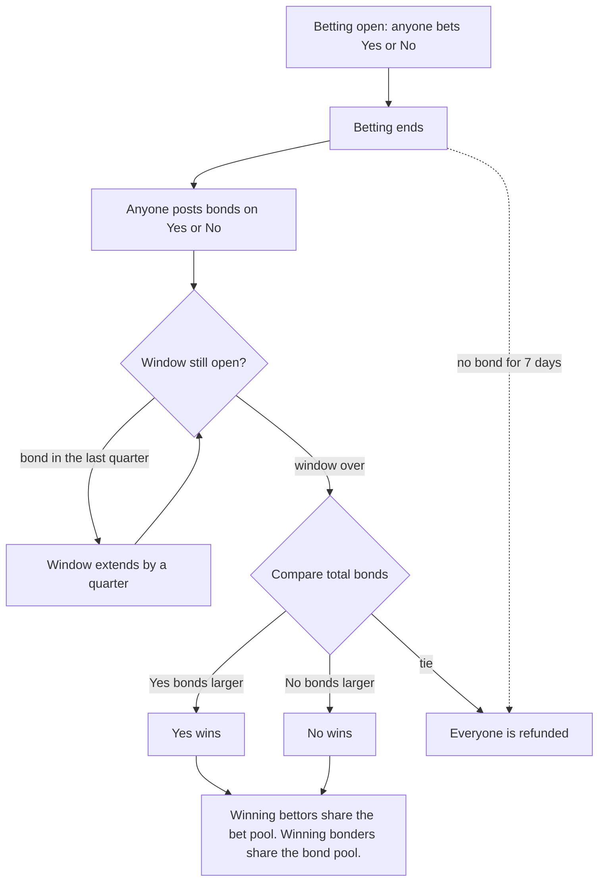

# Bond Market

A prediction market for Portaldot V3 testnet. Anyone can create a Yes/No question, bet on it, and the result is decided by a bond war instead of an oracle.

Built for Portaldot Hacker House 2026, track: Ecosystem DApps.

> Status: testnet prototype, not audited. Do not use real funds.

## The problem

A prediction market needs someone to say what really happened. A blockchain cannot know "did it rain tomorrow". Existing designs either pay for an external oracle, or trust one person (the market creator, then a contract owner for disputes) to report and judge. That person can cheat.

## What this project does differently

**The result is decided by whoever puts more money behind it, with no oracle and no admin.**

1. Betting closes at the deadline set by the creator.
2. Then anyone can post a bond on Yes or No. The first bond opens a resolution window.
3. During the window anyone can add more bond to either side, so a wrong claim can be outbid.
4. When the window ends, the side with the larger total bond wins. The losing bonds are shared among the winning bonders.

Lying is expensive: you must out-bond everyone who disagrees, and they profit by doing so.

Extra safety rules:

- **Late-bond protection:** a bond posted in the last quarter of the window extends the window by a quarter, so the other side always has time to answer a last-second bond. Each extension costs the extender real bond money.
- If bonds tie, or nobody posts a bond within 7 days after betting ends, everyone gets their money back.
- The contract has only 5 state-changing functions (`createMarket`, `bet`, `postBond`, `finalize`, `claim`). No owner, no admin, no fee. A test checks this.

## How it works

- Bets and bonds are paid in the network's native token. No token approval step is needed.
- Every market has a **category**: Sports, Esports or Crypto. The creator picks it when creating the market, and the web app can filter by it. The category is only a label, it does not change any rule.
- Bet payout: winners share the whole bet pool in proportion to their bet.
- Bond payout: winning bonders share the whole bond pool in proportion to their bond.
- Worked example: Ann bets 1 on Yes, Ben bets 3 on No. Chi bonds 5 on Yes, Dan bonds 2 on No. Yes wins. Ann receives 4, Chi receives 7, Ben and Dan receive nothing.

### How the winner is decided



Two separate layers: the larger total **bond** decides which side wins, then the winning side is paid from two pools.

| Person | Action | Result in the example (Yes wins) |
|---|---|---|
| Ann | bets 1 on Yes | receives 4 (the whole bet pool, she is the only Yes bettor) |
| Ben | bets 3 on No | loses 3 |
| Chi | bonds 5 on Yes | receives 7 (the whole bond pool, she is the only Yes bonder) |
| Dan | bonds 2 on No | loses 2 |

The contract never checks what really happened. It relies on incentives: to push a wrong result you must out-bond everyone who disagrees, and they profit by doing so.

Full spec: [docs/references/design-spec.md](docs/references/design-spec.md). Diagrams: [docs/architecture.md](docs/architecture.md).

## Quick start

Requirements: Node.js 20 or newer (LTS). The first compile downloads the Solidity compiler, so it needs internet.

```
npm install
npm test
```

Run everything on a local fake chain (recommended before touching testnet). Use two terminals:

```
# terminal 1
npm run node

# terminal 2
npm run deploy:local
npm run demo:local
```

Run on Portaldot testnet:

```
# PowerShell on Windows
Copy-Item .env.example .env
# then open .env and fill PRIVATE_KEY with a fresh test wallet (never a wallet with real funds)

npm run check:network     # checks the network, deploys a tiny Ping contract
npm run deploy:testnet
npm run demo:testnet
```

The scripts save addresses and transaction hashes in the `deployments/` folder.

## Web app

A Next.js + wagmi app in `web/` with a light and a dark theme (follows the system setting, with a toggle): connect MetaMask, search, filter by category and sort markets, open a market on its own shareable page, see your own positions and what you can claim in a Portfolio page, check an activity chart read from chain events, confirm every bet with a press-and-hold button, list markets with live countdowns and Yes/No bars, create a market, bet, post bonds, finalize and claim. Every transaction button shows its state: waiting for signature, confirming, done (with an explorer link when one is configured), or failed with a readable reason.

```
# with the local node running and the contract deployed (see above)
cd web
npm install
Copy-Item .env.local.example .env.local   # set NEXT_PUBLIC_NETWORK and NEXT_PUBLIC_MARKET_ADDRESS
npm run dev                               # open http://localhost:3000
```

For the local network, add it to MetaMask (RPC `http://127.0.0.1:8545`, chain ID 31337) and import one of the test accounts printed by `npm run node`. These keys are public and only work on the local fake chain.

End-to-end test (drives a real Edge browser through the whole flow with a mock wallet backed by the local node):

```
cd web
npm run test:e2e
```

## Testnet deployment

The current contract (**v2**, the code in this repository) is deployed on Portaldot V3 testnet. The earlier version (v1) submitted for the Week 2 check-in is kept below as evidence.

| Item | Value |
|---|---|
| Network | Portaldot V3 testnet (chain ID 420420777) |
| Deployer | `0x7d2aa1D951D7AB5F005527530b3582d1ADC20798` |
| **PredictionMarket v2 address** | `0xA0E8abFC1fD958e5900b87963B4c460F980ef86C` (resolution window 60 s for the demo) |
| v2 deploy tx | `0xee5935a9a5b72262094561c442057d72e27ea69eb4b36228506d85ca4d9eaba0` (block 229897) |
| v2 demo: create market | `0xf907090d06d928e2b8c1a17af1ec948cbdbc9a8a8582266b10c30f4798fa723c` |
| v2 demo: bet Yes | `0xe5490d265680476789454095a1420114ebc68dc8a64d323e876bbf2acfac275c` |
| v2 demo: bond Yes | `0x603c287c35e465348dd6b4f537eebb45334e04c0c910b745949b3b681fdf3f85` |
| v2 demo: finalize | `0xaab11da344f310aa864cac516454df3f81099cd4638bbf68ba42a36314eecf91` |
| v2 demo: claim | `0xe3665c59684ce9d9c3407fa4a84ed75014f60b275bfc2ee4005add16fdedbe50` |

Earlier evidence (check-in, v1 contract, kept in `deployments/v1/`):

| Item | Value |
|---|---|
| Network check: `Ping` contract | `0x45E235E87f4c73e402141dA4d548D6BE4dfe562b` |
| `Ping` deploy tx | `0x6a14078835edddb30283aa7b1c6d729982e0a8cfd685e3dde6cdb714e0cccf65` |
| v1 PredictionMarket address | `0xF73AF8c6a914d390A4F17FFa28535aa26c23B659` |
| v1 deploy tx | `0xa03b90eef388a35279637ee4c423f57785ef84694c16f28485553c4822eecaa1` |

Deploying on pallet_revive is expensive because of the storage deposit: v1 (6.7 KB) cost about 530 tPOT and v2 (5.3 KB, 21 percent smaller) about 420 tPOT, plus roughly 45 tPOT for the full demo. The web app points to this deployment when you set `NEXT_PUBLIC_NETWORK=testnet` and `NEXT_PUBLIC_MARKET_ADDRESS=0xA0E8abFC1fD958e5900b87963B4c460F980ef86C` in `web/.env.local`.

## Contracts

| File | Purpose |
|---|---|
| `contracts/PredictionMarket.sol` | Markets, bets, bond war, payouts |
| `contracts/Ping.sol` | Tiny contract used to check the network works |

## Tests and security checks

- 30 tests in `test/market.test.js` cover market creation, betting rules, bonds and the resolution window, late-bond protection, outcome selection, payouts, refunds (tie, nobody bet on the winner, no bond for 7 days), double claim, and the absence of admin functions.
- Slither static analysis: no high or medium findings. Two notes: the contract compares against `block.timestamp` (intended, deadlines are in seconds or days and validators can only shift it by seconds), and it sends native token with a low-level call (guarded by `nonReentrant` and marks the position as claimed before sending).

## Third-party code

- [OpenZeppelin Contracts](https://github.com/OpenZeppelin/openzeppelin-contracts) (MIT license): ReentrancyGuard.
- Hardhat and its toolbox for compiling and testing.
- Next.js, React, wagmi, viem and TanStack Query (MIT) for the web app. Playwright (Apache 2.0) for the end-to-end test.
- [Instrument Serif](https://fonts.google.com/specimen/Instrument+Serif) (SIL Open Font License 1.1) for the large headline, bundled at build time through `next/font`.
- Slither (static analysis) and Mermaid (diagrams) are used as development tools only, none of their code ships in the app.
- The visual style (serif headline with an accent word, soft glow, monospace figures) was inspired by general design principles seen on a public landing page. No logos, text, fonts or code were copied.
- The idea of a Yes/No market comes from Polymarket. The idea of refunding after a long wait with no resolution was inspired by [0xassou/wager](https://github.com/0xassou/wager). All contract code here was written from scratch for this hackathon, no code was copied.

## AI assistance

Most of the code in this repository (contract, tests, scripts, web app, documents) was written by Claude, Anthropic's AI assistant, working inside Claude Code. The project owner chose the idea, made the design decisions (bond-war resolution instead of an oracle, the 7-day refund, late-bond protection, no admin and no fee, native token only), reviewed every step, ran the tests, and ran the deployment on Portaldot testnet with their own wallet.

The working agreement and every decision the AI had to take on its own are kept in the repository: [CLAUDE.md](CLAUDE.md) (rules and checkpoints) and [docs/implementation-notes.md](docs/implementation-notes.md) (decisions, findings, open issues).

## Known limitations

- A very rich actor can win the bond war, but must out-bond all other bonders combined.
- Late bonds extend the window, but each extension needs fresh bond money, so a very rich actor can keep out-bonding smaller ones. The size of the bond is the defense, not a rule.
- Pool-sharing (parimutuel) payouts, no live price like the real Polymarket.
- Not audited.

## Project structure

```
contracts/   Solidity contracts
test/        Hardhat tests
scripts/     check-network, deploy-market, demo-market
web/         Next.js frontend and its end-to-end test
docs/        architecture, implementation notes, references
archive/     the earlier Launchpad idea, not compiled
```

## X posts

Links to posts about this project will be added here.

## License

MIT
