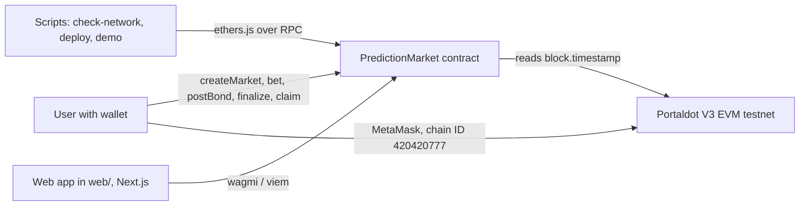
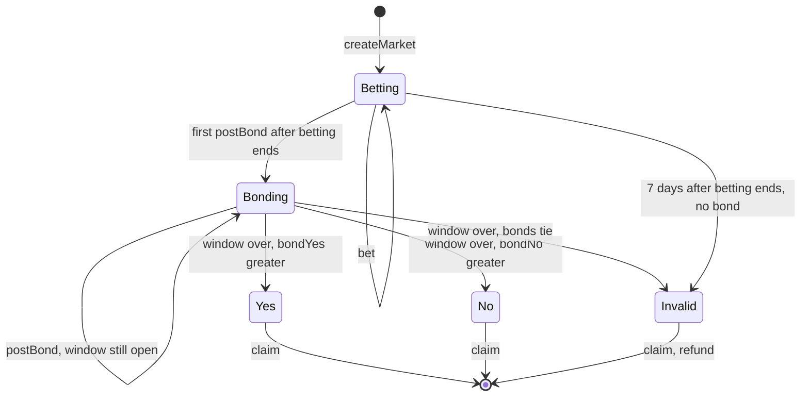
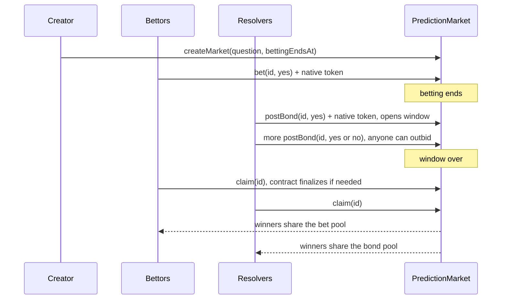

# Architecture

Sơ đồ dùng Mermaid, GitHub hiển thị trực tiếp. Dùng nguyên cho hồ sơ check-in (hoặc chụp ảnh sơ đồ).

## Các thành phần

Chỉ có một contract chạy trên chuỗi: `PredictionMarket`, giữ mọi thị trường và tiền. Script chạy ngoài chuỗi để deploy và demo. Frontend Next.js nằm trong `web/`, đọc và ghi trực tiếp vào contract qua ví người dùng.

## Trạng thái của một thị trường

## Luồng một thị trường từ đầu đến cuối

`claim` có `nonReentrant`, đánh dấu `claimed` trước khi gửi tiền.

## Dữ liệu lưu trên chuỗi

Mỗi thị trường (struct `Market`):

| Trường | Ý nghĩa |
|---|---|
| question, creator | Câu hỏi và người tạo (địa chỉ khác 0 nghĩa là tồn tại) |
| bettingEndsAt | Hết giờ này ngừng cược, bắt đầu cho cọc |
| windowEnd | Hết giờ này chốt kết quả, bằng 0 nếu chưa ai cọc |
| poolYes, poolNo | Tổng tiền cược mỗi phe |
| bondYes, bondNo | Tổng tiền cọc mỗi phe |
| result | Pending, Yes, No hoặc Invalid |

Mỗi người trong mỗi thị trường (struct `Position`): `betYes`, `betNo`, `bondYes`, `bondNo`, `claimed`.
